## 1、uv环境安装

网址：https://docs.astral.sh/uv/#highlights

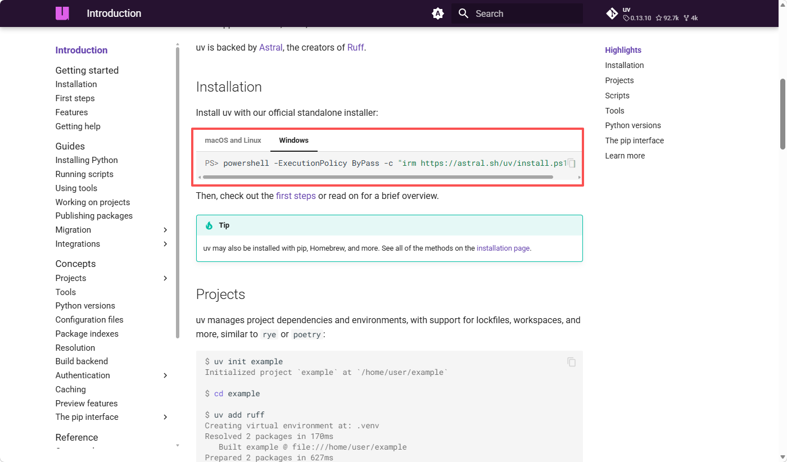

使用管理员方式打开power shell

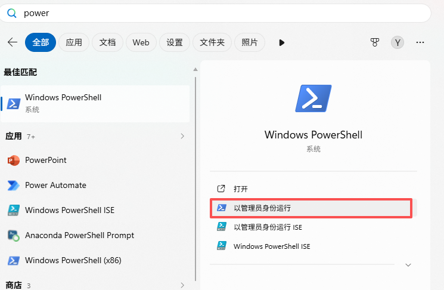

复制网页上面的下载命令进行下载

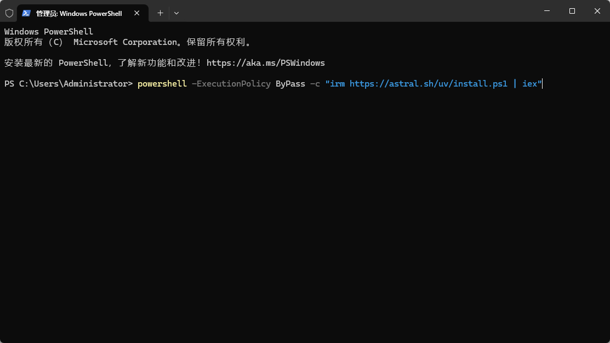

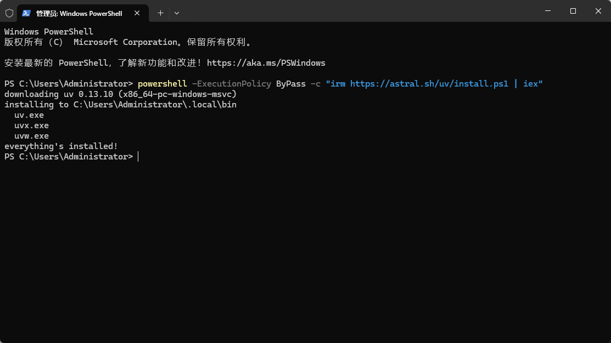

## 2、部署uv环境

新建一个文件夹，然后在上面的地址栏中全选重新输入cmd打开命令窗口

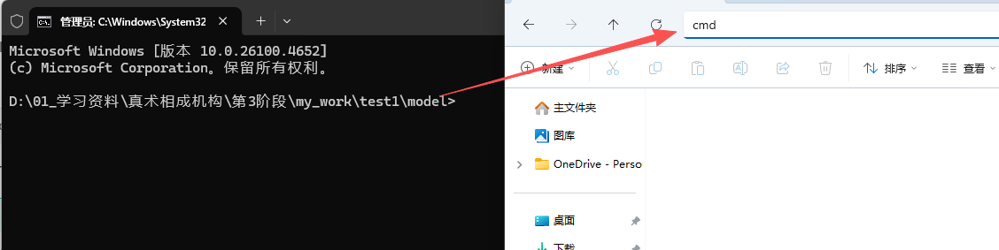

命令 uv python list

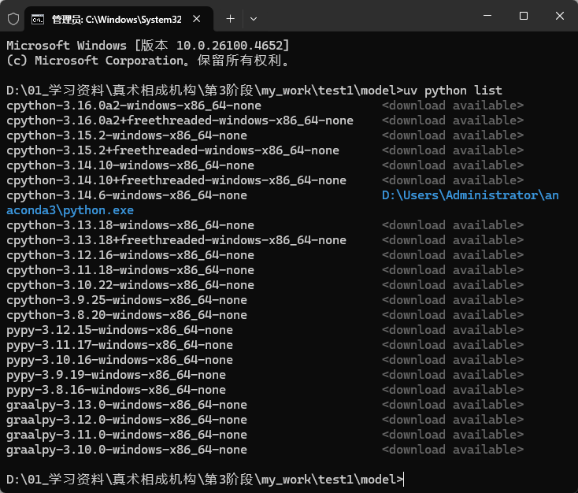

在该地址下载python版本 

命令：uv python install 3.12

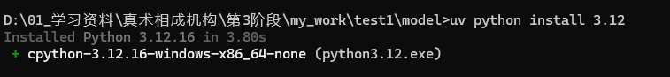

在当前目录（model 文件夹）初始化 uv 项目

命令：uv init . -p 3.12

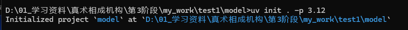

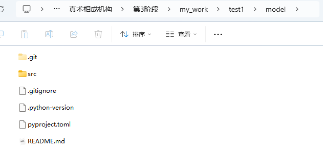

创建虚拟环境 .venv 

命令：uv vevn

后续装的依赖都在这个文件夹中

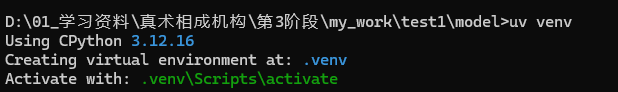

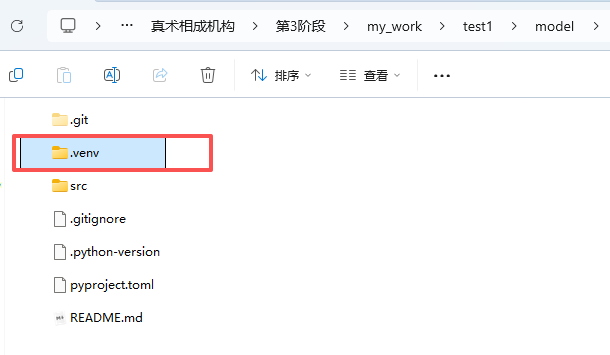

安装依赖

命令：uv pip install openai

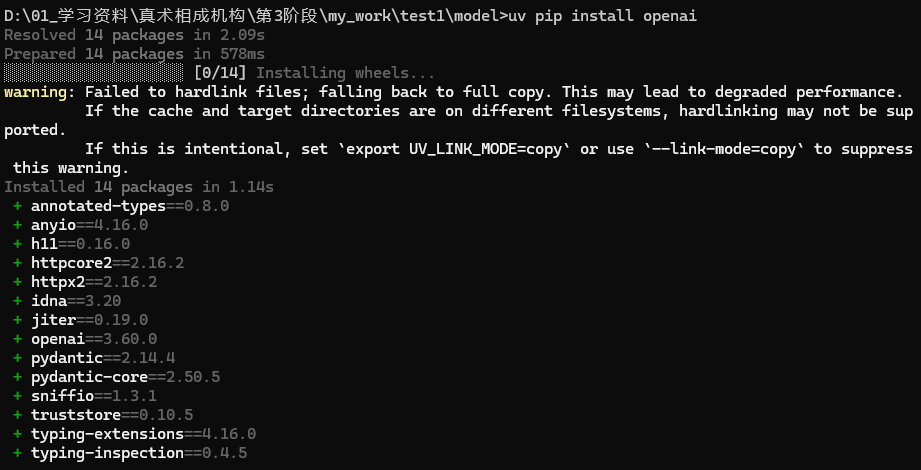

## 3、下载ollama

网址：https://ollama.com/download

下载完之后需要修改模型默认下载地址，系统默认是C盘，需要自己修改

在开始页面输入ollama打开，接着选择settings进行设置即可

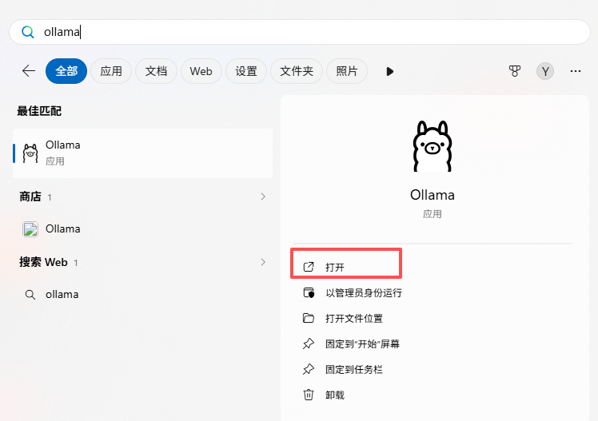

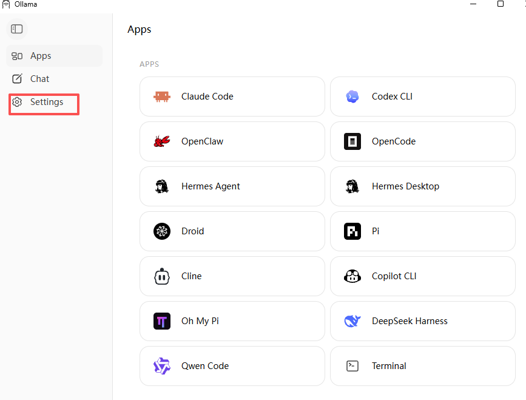

以上完成之后，网页打开ollama，选择model，因为千问在细分领域做得比较好，再加上版本非常多，再输入qwen，根据电脑性能进行模型的选择

此处选择qwen3.5   其中还要很多分类，细选是qwen3.5：4b

下载模型

命令：ollama run qwen3.5:4b

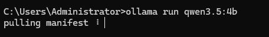

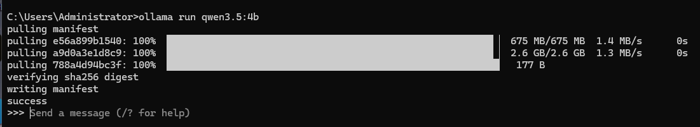

此处可以直接对话

退出对话使用  /bye

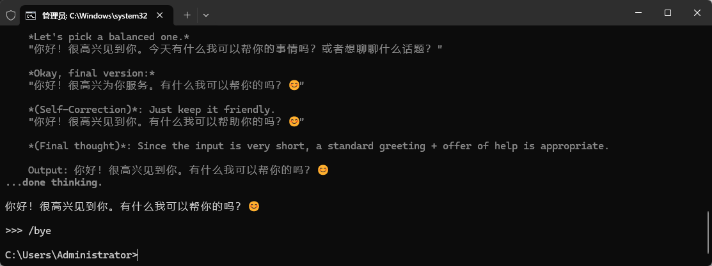

命令：ollama ps                作用：查看**当前正在运行、加载在内存里**的模型

命令：ollama list               作用：查看**本地已经下载保存到硬盘**的所有模型（不一定正在运行）

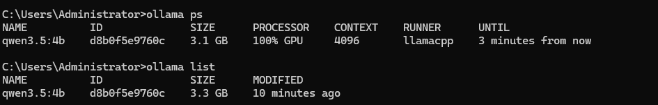